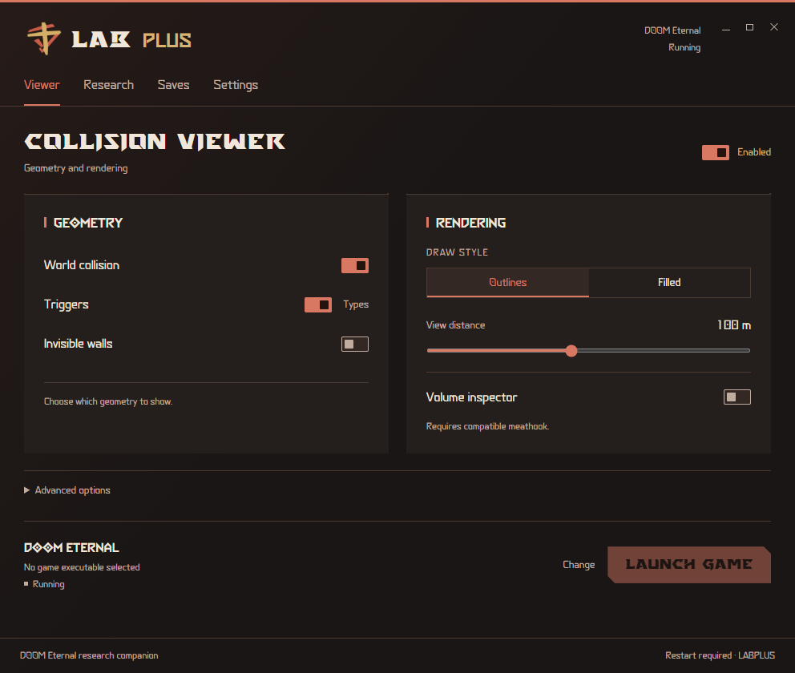

# LAB Plus

Windows research and practice companion for **DOOM Eternal**, featuring the **Slayer Workspace** interface, original Eternal typefaces and the red/gold Plus emblem. The interface is fully English; technical identifiers and console controls use `labplus` / `labplus_`.

[Download Windows x64](https://github.com/IlyaTsyganov/LAB-Plus/releases/latest) · [Detailed Wiki](https://github.com/IlyaTsyganov/LAB-Plus/wiki) · [Console reference](https://github.com/IlyaTsyganov/LAB-Plus/wiki/Console-commands-and-cvars)



## Features

- A dedicated **LAB** tab with three independent speedometers, signed vertical speed, Lighting Fix, Modbot input protection, AMD driver-line hiding and red-screen opacity. Its commands use `labplus_`.
- Compact **LAB Plus (MR)** indicators, filtered changed cheat cvars and active noclip/notarget/god states.
- Compact 820×800 layout, common control sizes across tool windows, per-tab Help and direct Discord/Wiki links.
- Independent shared outline/fill colors and fill opacity for world collision, triggers, invisible walls and the crosshair inspector.
- Collision viewer: independent world collision, triggers and invisible walls; filled/outline style; 20–200 m distance.
- Persistent trigger-class and hierarchical folder filters, crosshair volume inspector, disabled-volume outlines and recent history.
- Research timeline: manual recording, in-game path, markers, search and complete CSV export.
- Movement Lab: named attempts, manual outcomes, up to six route overlays, player collider, velocity, target distances and surface projections.
- Entity links: navigable observed-reference graphs with fit, zoom, pan and JSON export.
- Before/after level comparison, changed-volume highlights and CSV/JSON export.
- Active encounter observations and optional native HUD; Inspector, Support plane and Encounters stack at the upper left with adjustable text size.
- **Invisible numbers**: living enemies grouped by active encounter, current/max HP and optional world HP bars; equipment, powerup, Sticky Bomb and current sync-clip countdowns; BATS and Fast DBlade state observations.
- Research points with physical/camera data, categories, notes and copyable return data.
- Checkpoint library plus authenticated same-account archives, reviewed restore and backup recovery.
- Scoped Vulkan launch and automatic early-version NVIDIA lighting correction.

## Install and run

Extract the **entire** release ZIP and run `LABPlus.exe`. Keep every included file/folder together. Install **.NET 10 Desktop Runtime x64** and **Microsoft Edge WebView2 Evergreen Runtime**. Select `DOOMEternalx64vk.exe` on Viewer beside Launch game, configure the matching outbound firewall block in DESRU, enable the viewer and launch the game through LAB Plus. The launch gate reads firewall state without changing it. First enable or a DLL update requires a full game restart.

See [installation](https://github.com/IlyaTsyganov/LAB-Plus/wiki/Installation-and-first-launch), [compatibility](https://github.com/IlyaTsyganov/LAB-Plus/wiki/Compatibility) and [troubleshooting](https://github.com/IlyaTsyganov/LAB-Plus/wiki/Troubleshooting).

## Compatibility and scope

The research Debug HUD uses the full viewport with a common font size, wrapping and automatic columns. Enemy HP/GK panels use EternalUi2Regular. Sticky Bomb shows separate countdowns for missing charges, with a shared deadline when all charges reload together; countdowns include verified maximum durations when available.

Invisible numbers resolves reflected game fields and marks unsupported values unavailable. Health, equipment/animation clocks and BATS calculation adapters are audited for all 22 recognized executable builds from 1.0 through 6.66 Rev 3.2. Player-lock countdowns use the actual player-release animation event, including Praetor Token and Gore Nest interactions. Retail data audits and synthetic fixtures establish compatibility; live gameplay acceptance remains feature- and patch-specific. Fast DBlade activates on a prepared Arbalest hit and persists until its actual one-shot charge override is spent.

LAB Plus activates only for the exact game process launched through its launcher. **Hide AMD driver line** also hides actual CPU/GPU labels from any manufacturer; when the driver row is visible, LAB Plus indicators and changed cheat cvars appear above it. See the [0.8.21 release notes](docs/releases/0.8.21.md) for the combined changes since 0.8.12.

The collision reader recognizes 22 audited executable profiles from 1.0 through 6.66 Rev 3.2. Research HUD/console integration requires a compatible, already-loaded meathook, which is not bundled; LAB speedometers, MR indicators and cheat-cvar monitoring use their independent validated adapters. Native cvar creation is audited for **6.66 Rev 3 only**. Live checkpoint loading is limited to **6.66 Rev 3 / TAG1 / slot 3**, same account, Cloud off and all runtime checks passing. Checkpoints use the game’s completed autosave containers.

The Viewer/LAB interface and 11 tool windows passed browser acceptance, including 125% and 150% scale, persistence and launch feedback. The LAB runtime passed 310 checks covering executed HUD/metrics code, input and tint, read-only cvar monitoring, concurrent text rendering and four real executable layouts. Viewer fixtures cover 22 profiles; independent appearance tests cover native colors and zero, partial and full fill opacity. These isolated tests do not prove the combined new build in a live game; it still needs in-game acceptance.

Collision decoding does not modify physics. The Vulkan loader loads the scoped layer at game startup; optional research integration uses engine APIs and the explicit checkpoint workflow can request an engine reload. LAB Plus is an unofficial community tool.

## Build

Requires Windows x64, the .NET 10 SDK and MSVC C++ Build Tools or LLVM-MinGW.

```powershell
./build-local.ps1
# Optional explicit portable native compiler:
./build-local.ps1 -NativeCompiler C:\tools\llvm-mingw\bin\clang++.exe
```

This builds the native layer, runs fixtures and managed/UI checks, and publishes the complete application to `publish`. See [Building and validation](https://github.com/IlyaTsyganov/LAB-Plus/wiki/Building-and-validation) for individual commands and test boundaries. Versioned Wiki sources are in [`docs/wiki`](docs/wiki).

The UI uses packaged HTML/CSS via WebView2. Screen state/actions are plain C# objects; the native host contains only one WebView2 and does not create the former native widget layouts. Windows file/folder pickers remain OS dialogs. `LABPlus.exe --preview` opens an isolated UI preview.

Data lives under `%LOCALAPPDATA%\labplus`; `LABPLUS_DATA_DIRECTORY` accepts an absolute override. LAB preferences are stored independently in its `hud` subfolder. Logs use `logs\labplus.log` beside the executable. First-use migration copies previous preferences and archives without modifying originals or overwriting existing LAB Plus data. See [Data and migration](https://github.com/IlyaTsyganov/LAB-Plus/wiki/Data-and-migration).

## License and attribution

Source is [GNU GPL v3](LICENSE), retaining history from [the original project](https://github.com/IlyaTsyganov/DEVIL). The read-only cheat-cvar monitor is adapted from [DESRU-Enhanced](https://github.com/IlyaTsyganov/DESRU-Enhanced). Vulkan-Headers, the [lighting correction](https://github.com/billymooreq/DoomEternal-v1.1--RTXFix) and WebView2 retain their included notices/licenses. DOOM Eternal typefaces and logo-derived assets remain the property of their respective owners; inclusion does not transfer ownership or grant additional rights. LAB Plus is not affiliated with or endorsed by id Software or Bethesda.
