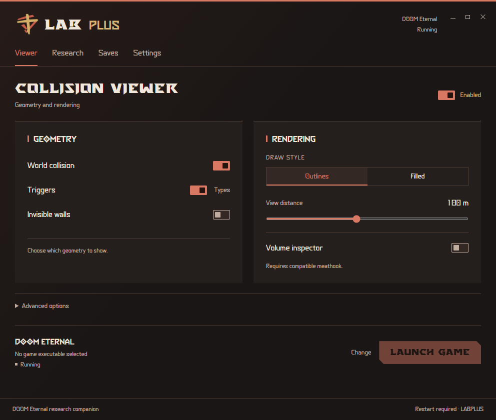

# LAB Plus

LAB Plus is a Windows companion for researching and practising DOOM Eternal: inspect collision and volumes, record routes, compare movement attempts, explore observed entity references and manage checkpoint archives.

The **Slayer Workspace** interface uses the original Eternal typefaces, a dark red gradient and the red emblem with a gold Plus. The application and this documentation are entirely in English. Technical names use `labplus`; console controls use `labplus_`.

## Start here

1. Download the Windows x64 ZIP from [Releases](https://github.com/IlyaTsyganov/LAB-Plus/releases/latest).
2. Read [Installation and first launch](Installation-and-first-launch).
3. Check [Compatibility](Compatibility), particularly before using console controls or live checkpoint loading.
4. Select `DOOMEternalx64vk.exe`, configure the Viewer and launch the game through LAB Plus.

## Guides

| Area | Guide |
| --- | --- |
| Geometry, style and distance | [Collision viewer](Collision-viewer) |
| Hierarchical filters, picking and history | [Trigger filters and volume inspector](Trigger-filters-and-volume-inspector) |
| Path recording, markers and CSV | [Research timeline](Research-timeline) |
| Attempts, collider, velocity and support angles | [Movement Lab and surface projections](Movement-Lab-and-surface-projections) |
| Reference graphs and before/after snapshots | [Entity links and level comparison](Entity-links-and-level-comparison) |
| Encounter manager observations and HUD | [Active encounters](Active-encounters) |
| Named locations, notes and return data | [Research points](Research-points) |
| Checkpoint library, archives and recovery | [Checkpoints and recovery](Checkpoints-and-recovery) |
| Every public cvar, command and alias | [Console commands and cvars](Console-commands-and-cvars) |
| Local storage and previous data | [Data and migration](Data-and-migration) |
| Startup, rendering and console problems | [Troubleshooting](Troubleshooting) |
| Source, dependencies and verification | [Building and validation](Building-and-validation) |

## Scope

LAB Plus is an unofficial community tool, unaffiliated with id Software or Bethesda. Collision decoding reads game data without changing physics. The Vulkan layer is loaded by the Vulkan loader at game startup. Optional research HUD and console integration use engine APIs through a compatible, already-loaded meathook. The checkpoint workflow can explicitly request an engine reload.

Automated profile fixtures are not equivalent to testing every feature in a live game. Read the compatibility and validation pages for the exact boundaries. Source is GPL-3.0; bundled third-party components and game assets retain their own notices and ownership.
